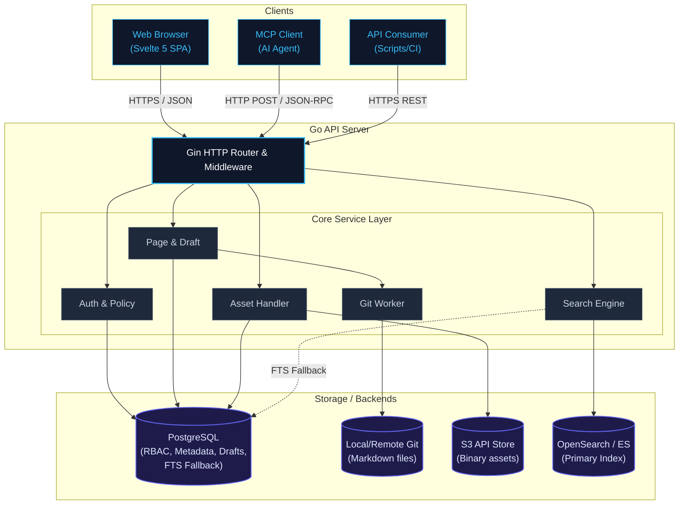
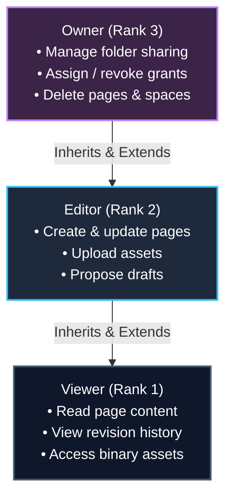
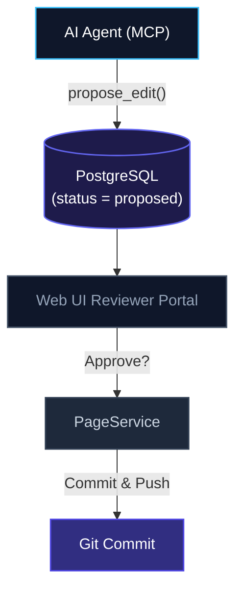

Knowledge management in modern engineering teams is undergoing a silent revolution. The way humans and AI agents interact with information is shifting. LivingKB was developed as a direct response to two powerful ideas: Andrej Karpathy's vision for an [LLM Wiki](https://gist.github.com/karpathy/442a6bf555914893e9891c11519de94f)—a knowledge base specifically designed for AI agents to read, write, and propose edits alongside humans—and Google's [Open Knowledge Format (OKF)](https://cloud.google.com/blog/products/data-analytics/how-the-open-knowledge-format-can-improve-data-sharing), which outlines a structured, semantic format to improve data sharing, cross-lingual concepts, and machine readability.

Traditional wikis are built for human-only consumption but remain opaque to AI, while raw Git repositories are ideal for versioning but inaccessible to non-technical users. To bridge this gap, I built [**LivingKB**](https://github.com/LivingKB/LivingKB)—a self-hosted, Git-backed company knowledge base that blends these philosophies. It provides a clean, modern Svelte 5 wiki SPA for human collaboration, serves as an AI-ready Model Context Protocol (MCP) server for agents, and uses Google's OKF-compatible concept paths to store translation-ready Markdown files directly in Git.

In this post, I'll dive into the architecture, design choices, and technical challenges of building this dual-engine, AI-collaborative knowledge platform.

---

## System Architecture

LivingKB is packaged as a single, lightweight Docker container containing a compiled **Go 1.22+ backend** and a built **Svelte 5 + Vite TypeScript SPA**. PostgreSQL serves as my metadata, draft, and permission registry, while a local or remote Git repository serves as the single source of truth for approved document snapshots.



---

## Centralized, Deny-by-Default RBAC

In a company-wide knowledge base, security is non-negotiable. LivingKB implements a strict, deny-by-default permission model. Policy checks are centralized in a dedicated `PolicyService` that intercepts every read, write, and search operation.

### Permission Levels and Hierarchy

Instead of a plain table, the inheritance and escalation flow of roles and capabilities can be modeled directly using a Mermaid diagram. Each rank builds on top of the capabilities of the lower ranks:



### Downward Inheritance

Grants flow downwards from parent folders to nested children. The policy engine evaluates all direct and inherited user or group grants and applies the highest resolved permission. Crucially:
* A nested folder or page cannot lower or restrict permissions inherited from above (ensuring structural predictability).
* Top-level space creators automatically receive Owner status.
* Any share mutation that would strip the final Owner from a folder or space is blocked at the database level to prevent orphaned content.

---

## Abstracting Git for End Users

My core design principle is: **Git is invisible to users.** End users should edit documents in a standard WYSIWYG/split-markdown editor and view revision histories without ever hearing terms like *index*, *push*, or *merge conflicts*.

### Server-Side Commits and Reconciliation
When an authorized user saves a page:
1. The backend writes the document as a clean Markdown file with structured YAML frontmatter containing metadata (title, tags, description) to the local disk.
2. The `GitService` executes an automated commit on a server-side Git repository using a dedicated git CLI worker.
3. Once committed, the metadata is cached in PostgreSQL `pages` for fast directory listing and index querying.
4. The system triggers background pushes to remote Git providers (e.g., GitHub or GitLab) if configured.

If the server boots up and detects a remote repository, it pulls the latest Markdown changes and automatically reconciles the PostgreSQL cache with the files in Git, acting as a self-healing pipeline.

### Translation & Multilingual Paths
LivingKB supports translations natively. In Git, files are stored using a clean, path-sanitized convention:
```
{folderPath}/{contentId}.{lang}.md
```
For example, a guide in English and Vietnamese would sit side-by-side:
* `engineering/runbooks/postgres.en.md`
* `engineering/runbooks/postgres.vi.md`

In the web interface, routing uses the clean concept path `/{lang}/{contentId}` instead of exposing raw file system paths or exposing space slugs unnecessarily, keeping links human-readable and SEO-friendly.

---

## Smart Document Import: Pluggable Conversion Engines

Transitioning from old document formats (like PDF, DOCX, XLSX, or PPTX) to a Markdown-based knowledge base is notoriously frustrating. Plain text copy-pasting strips formatting, breaks tables, and loses mathematical layouts.

To address this, I integrated a dedicated document import pipeline directly into the Web UI via the `/api/import/convert` endpoint. This service hooks into pluggable document parsing backends, giving users two state-of-the-art conversion engine choices:

1. **Microsoft MarkItDown**: Excellent for converting standard Office suite documents (Word, Excel, PowerPoint) into clean, readable Markdown layout formatting.
2. **IBM Docling**: An advanced document layout analysis engine, perfect for processing complex PDF files, parsing tables accurately into Markdown grid formats, and preserving formulas.

When a user drags a file into the editor, the file size is verified against configurable import limits (`DOCUMENT_IMPORT_MAX_BYTES`). The file is then streamed to the selected parser engine, which extracts structural content and returns normalized Markdown directly to the split-view editor. The user can review, edit, and save it as a draft or publish KB page.

---

## Bridging the AI Gap: Model Context Protocol (MCP)

To make LivingKB a first-class knowledge hub for AI, I built a native **Model Context Protocol (MCP)** server directly into the Go application. Large Language Models (LLMs) and coding assistants can connect directly to the KB via secure, per-user authenticated MCP sessions.

### Safe AI Writes via Proposals
While AI agents can read pages they have access to, they are restricted from modifying production content directly. Any write tools like `propose_edit` or `propose_create` generate reviewable **Drafts/Proposals** in PostgreSQL rather than writing directly to Git.



A human reviewer accesses a **Draft Review Portal** in the Svelte UI, inspects a side-by-side background diff, and either approves or rejects the draft. Only on approval does the change get committed to Git.

---

## Performance & Asset Management

A common mistake with Git-backed wikis is storing binary files (images, PDFs) inside Git. Over time, this bloats the repository size and degrades performance. 

LivingKB resolves this by keeping Git purely textual:
* **Asset Offloading**: All uploaded binary assets are routed through the `AssetService` to an S3-compatible object store (like AWS S3 or MinIO) using opaque keys.
* **Stable References**: Inside the Markdown file, assets are stored as stable URI references: `asset://<asset_uuid>`.
* **Dynamic Resolution**: When rendering Markdown in the frontend, the server parses `asset://` URIs and replaces them with short-lived, presigned S3 URLs (expiring in 15 minutes) after verifying the user's `asset:read` permission.

---

## The Frontend: Svelte 5 & Nebula Forge Styling

The user interface is built on **Svelte 5** and styled using vanilla CSS, utilizing CSS custom properties for seamless real-time light/dark theme switching. 

### Svelte 5 Runes
Svelte 5's new reactivity system (`$state`, `$derived`, `$effect`) proved incredibly useful for managing complex client-side state:
* **Hierarchical Page Tree**: The collapsible sidebar builds a recursive directory structure client-side, derived Reactively from flat list paths using `$derived`.
* **Real-time Split Preview**: The Markdown editor uses active runes to sync the input text block with a sanitized live preview pane.
* **Responsive Layouts**: User preference settings (such as sidebar collapse states) are bound to `$state` and saved in `localStorage` dynamically.

---

## Deployment & DevOps Invariants

LivingKB's production deployment is optimized for zero-overhead self-hosting. 
* **Scratch-based Multi-Stage Dockerfile**: The final runtime container is built on top of a minimal base image (copying only the compiled Go static binary, musl dependencies, CA certificates, and the `git` binary from an Alpine intermediate stage).
* **SMTP Outbound Only**: To simplify email setups, I avoided hosting a complex SMTP mail server in the container. LivingKB acts as an outbound SMTP client, storing encrypted credentials at rest and connecting over SSL/STARTTLS to external mail providers (e.g. Resend, SendGrid).

---

## Lessons Learned

Building LivingKB as a solo developer was an intensive study in architecture, security boundaries, and the evolving relationship between human and machine collaboration. Several critical technical lessons emerged from this project:

### 1. Guarding AI Integration with Human-in-the-Loop Approval
Karpathy's LLM Wiki concept is exciting because it gives AI models active participation in knowledge curation. However, in practice, giving LLMs direct access to write and push commits to production leads to chaos and hallucination-fueled corruption of data. 

**The Lesson:** AI writes must always be *proposals*, not direct mutations. By intercepting MCP tools at the API boundary and forcing them into a reviewable draft state in PostgreSQL, I successfully harnessed the generative power of AI while preserving a strict, human-in-the-loop verification gate.

### 2. Separating Concept ID from Localization
Adopting Google's Open Knowledge Format (OKF) layout taught me the importance of stable concept modeling. Translating wiki pages often leads to complex, fragmented folder trees where permissions diverge (e.g., `en/guides/setup.md` vs `vi/huong-dan/cai-dat.md`).

**The Lesson:** By mapping content to a stable, language-independent Concept ID/Path and storing translations side-by-side (e.g., `guides/setup.en.md` and `guides/setup.vi.md`), I kept the path-based authorization logic completely isolated from the language view. The RBAC engine evaluates the normalized path, making access control simple, clean, and highly maintainable.

### 3. Git is a Fantastic Database—With Guardrails
Using server-side Git as a version-controlled content engine provides unmatched transparency. However, Git wasn't built to be a high-concurrency database. 

**The Lesson:** You cannot expose Git directly to public API writes without application-level safety layers. I had to enforce path-traversal sanitation, concurrent execution locks in `GitService`, and a dual-engine architecture where PostgreSQL handles real-time queries (directory listing, permissions, search cache) while Git acts as the durable storage backend.

### 4. Solo-Developer Stack Synergy: Go + Svelte 5
When developing a system of this scale alone, developer velocity and deployment simplicity are paramount.

**The Lesson:** Keeping the stack lean pays massive dividends. Serving the Svelte 5 TypeScript SPA directly from the Go binary eliminated CORS headaches, simplified the auth cookie/JWT configurations, and reduced deployment to a single `docker run` command. Furthermore, Svelte 5's reactive runes (`$derived` and `$state`) made implementing client-side hierarchical page trees and side-by-side visual diff comparisons fast and painless.

## Conclusion

LivingKB proves that you don't have to compromise between developer-friendly Git history and user-friendly wiki collaboration. By combining the structured organization of Google's Open Knowledge Format (OKF) with the AI-native workflows of Andrej Karpathy's LLM Wiki, I built a self-hosted platform that serves both human teams and AI agents safely and securely.

The key to success was maintaining clear boundaries: Git for durability, PostgreSQL for state and permission rules, S3 for assets, and Model Context Protocol for secure AI collaboration. If you are building a similar system, focus on centralizing your authorization layer early, restrict AI inputs to reviewable drafts, and treat Git as your primary, immutable source of truth.

---

*LivingKB is open-source. You can explore the Go backend, Svelte 5 SPA, and full architecture on the [GitHub Repository](https://github.com/LivingKB/LivingKB).*
